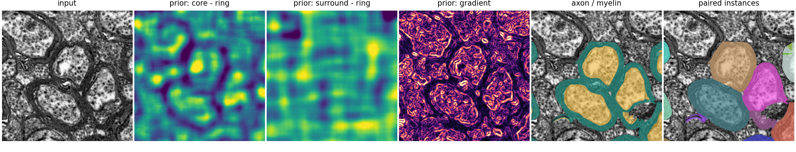
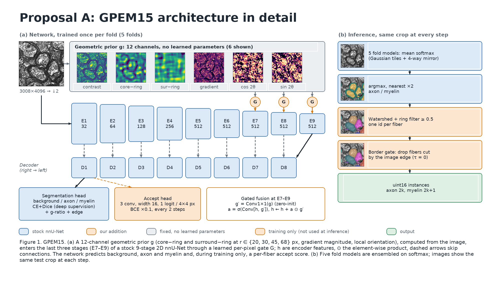
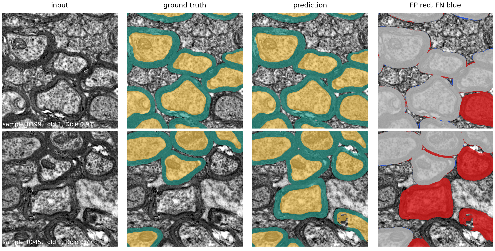
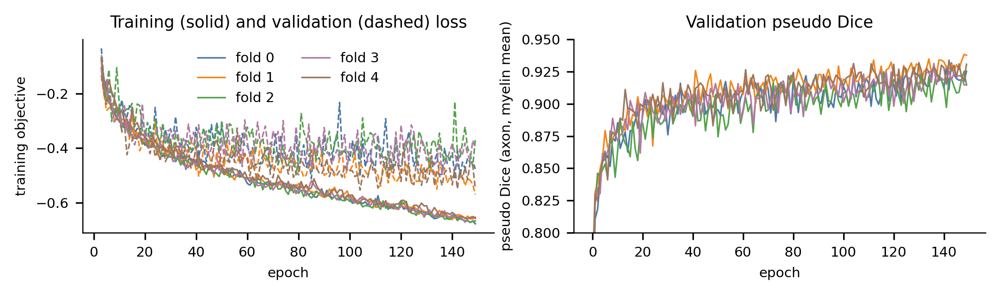

GPEM15: Geometric-Prior nnU-Net for Axon and Myelin Instance Segmentation in TEM
================================================================================

Our solution for the [SIPAIM 2026 TEM Axon & Myelin Segmentation Challenge](https://alexandrojim.github.io/tem-challenge/).

<p align="center">
  
</p>

* * *

Abstract
--------

**Method.** A 2D nnU-Net receives a fixed, twelve-channel geometric prior (core, ring and surround of the fiber)
through learned gates that start at zero. Instances are assembled with a watershed, a ring test and a border gate.

<p align="center">
  
</p>

**Results.** Five-fold cross-validation on the 266 annotated images, one model per fold.

| Fold | DSC mean | HD95 (nm) | g-ratio MAE |
|------|----------|-----------|-------------|
| 0 | 0.883 | 591 | 0.0120 |
| 1 | 0.907 | 416 | 0.0132 |
| 2 | 0.878 | 566 | 0.0125 |
| 3 | 0.882 | 563 | 0.0142 |
| 4 | 0.889 | 487 | 0.0133 |
| **Mean** | **0.888** | **525** | **0.0130** |

<p align="center">
  
</p>

<p align="center">
  
</p>

* * *

Highlights
----------

- **Geometry as a prior:** 12 maps from the image, no learned parameters.
- **Closed-at-start fusion:** zero-initialized gates in the last 3 encoder stages.
- **Metric-aware training:** g-ratio and edge terms, plus an accept head used only in training.
- **Native nnU-Net inference:** 5-fold softmax ensemble.

Models
------

Weights of the five folds: `code/checkpoints/fold_{0..4}/checkpoint_final.pth`. The submission averages their softmax.

Acknowledgements
----------------

Thanks to the challenge organizers and the Paris Brain Institute (ICM) for the dataset. Built on
[nnU-Net](https://github.com/MIC-DKFZ/nnUNet). Authors: Danitza Bermejo, Gabriel Omar Duran Ruiz,
Valeria Porras Cruzado, Dhiago G. Llanos (Pontificia Universidad Católica del Perú).

Usage
=====

Installation
------------

```
pip install -r code/requirements.txt
export nnUNet_raw=<raw> nnUNet_preprocessed=<preprocessed> nnUNet_results=<results>
```

Data
----

Challenge data in `data/raw/train_samples` and `data/raw/train_instance_labels`. Labels: `0` background,
`1` artifact (ignored), even `X` axon, `X+1` its myelin. Trained as dataset 505: images downsampled by 2.

Training
--------

```
python code/train.py --model nnunet --dataset 505 --fold 0 --trainer gpem15
```

Inference
---------

```
python code/predict.py --model-folder code/checkpoints --images <test dir> --out predictions --folds 0 1 2 3 4
```

_Note_: the network is trained at half resolution. Downsample images by 2 (2×2 mean) before predicting and
upsample the class map afterwards; full-resolution input lowers the fold-0 Dice from 0.884 to 0.818.

Evaluation
----------

```
python analysis/metrics.py <predictions dir> <ground-truth dir>
python otros/evaluar_5folds.py cv_results.json
```

More: [`METHOD.md`](METHOD.md) (full method), `figures/GPEM15_arquitectura.pptx` (editable diagram).
